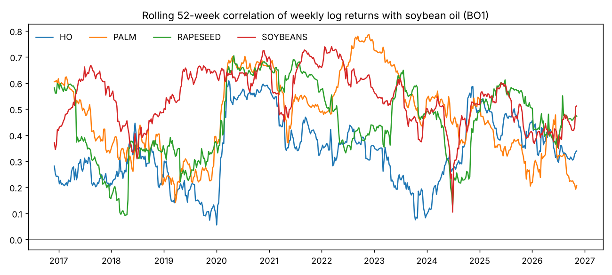
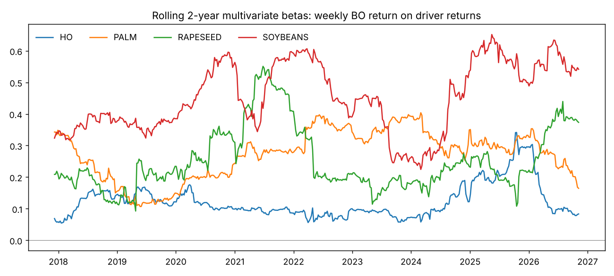
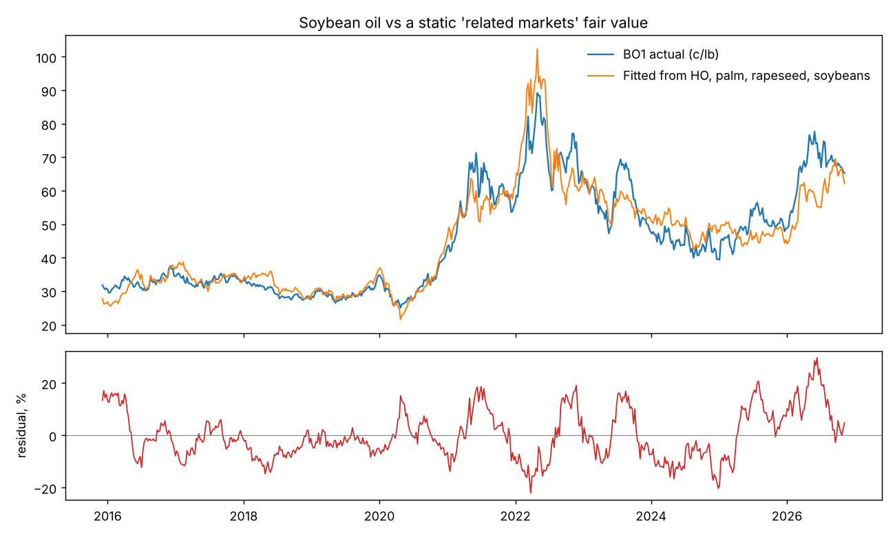
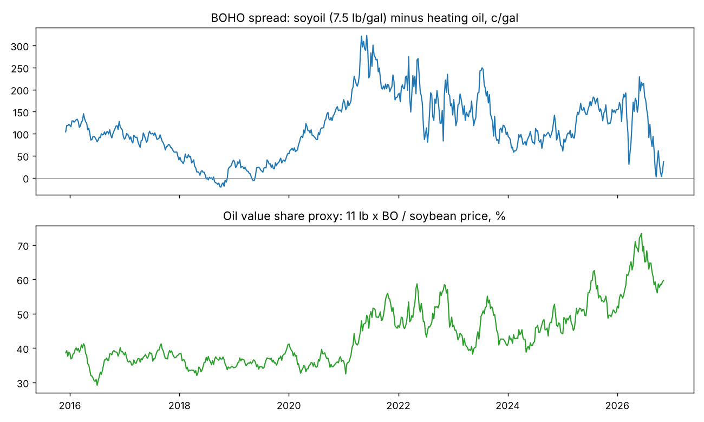
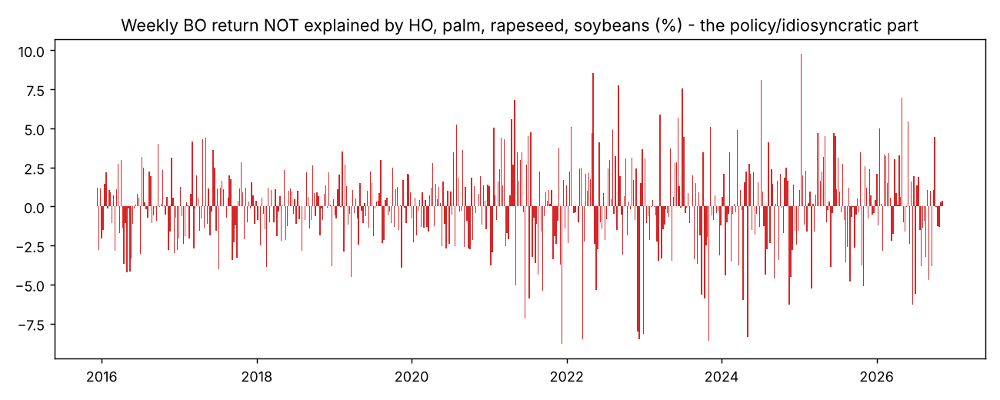
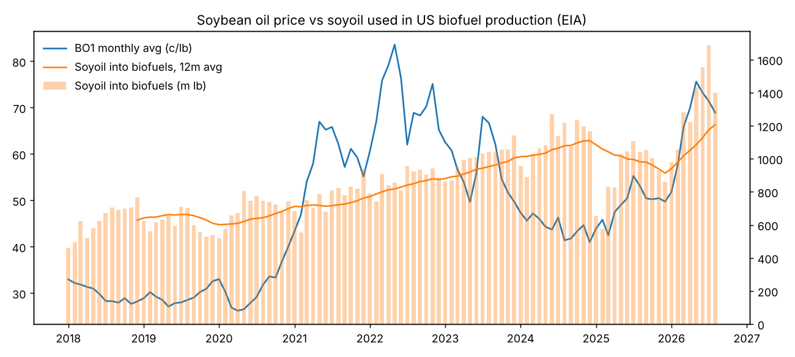

# Soybean oil (CBOT BO1): what moves the price, statistically

Data: `data/BO_relationships.xlsx`, Dec 2015 – 4 Nov 2026. Reproduce with `python3 analysis.py`, which writes `results.json` and `charts/`.
The prices are daily Bloomberg closes, analysed as weekly (Friday) log returns: 567 weeks. The EIA feedstock and balance-sheet data are monthly, through Aug 2026 (feedstock) and Jul 2026 (balance sheet).

> **Correction, 5 Nov 2026.** The `inputs 1` sheet pulls the `PX_CLOSE_1D` field, which is the *previous* day's close, so all prices were dated one trading day late. `load.py` now re-dates them; this was verified against the `PX_LAST` data in `RD_margins.xlsx`. After rerunning on the corrected dates:
> - The full-sample weekly R² is 0.50, not 0.53. The 2024–26 R² is unchanged at 0.44.
> - Every weekday sampling gives R² in the 0.45–0.54 range.
> - The out-of-sample predictive results still fail: R² −10.0% against a random walk. The basket search still finds no basket that beats "no change" in 2023–26 at any horizon (best: −4.0% at 13 weeks).
> - **The specific "largest unexplained weeks" list is not robust to which weekday is sampled. Treat the policy-week attributions as hypotheses to test on daily data, not as findings.**
> - The tables below are the original Thursday-dated run. The rerun numbers are in `results.json` and `basket_results.json`.

---

## 1. Short answer

1. **Related markets explain about half of BO's weekly moves, and the other half is a missing variable.** Weekly returns of soybeans, palm, rapeseed and heating oil together give R² = 0.53. In 2024–26 that falls to 0.44. The part left over is concentrated in US biofuel-policy weeks. Your file has no variable for that part: no RIN, LCFS or 45Z data.
2. **Soybeans are the biggest single association (36% of explained variance), but the causality is partly circular.** Oil is about 40–50% of a soybean's crush value, so BO moves beans too. Treat beans as a "complex" factor, not an independent driver.
3. **Heating oil matters more and more.** Its share of explained variance doubled from 13% (2016–20) to 29% (2024–26). Palm went the other way, from 35% to 11%. The US soyoil market has decoupled from the world vegoil market, and the link now runs through diesel and biofuel margins.
4. **Nothing in the file predicts BO.** Lagged drivers and an error-correction term give a *negative* out-of-sample R² against a random walk (−9.7%, 409 weeks). Granger tests are insignificant. These variables explain moves *at the same time*; they are not leading indicators.
5. **There is no stable long-run "fair value" from related markets.** A cointegrating relation exists over the full sample and in 2016–20. It breaks down in 2024–26: Johansen rank 0, and the elasticities flip sign. A fair-value model fitted on history would have mispriced BO by as much as +28% in 2026.
6. **The EIA fundamentals data is not usable as a price signal in its current form.** It has data-integrity problems (section 6). Soyoil-into-biofuel volume has a year-on-year correlation of about 0.05 with price. *Total* feedstock demand does better (0.66, once the corrupted 2023–24 data is excluded).

---

## 2. Problems with the input set (fix these before trusting any model)

| Issue | Why it matters |
|---|---|
| **No RIN (D4/D6), LCFS, BTC/45Z or RVO data** | These set the biofuel margin, which is the main demand pull for US soyoil since 2021. This is the largest gap in the framework. The unexplained weeks (section 5) are mostly policy weeks. |
| **No soybean meal (SM1)**, although it is listed as Ticker 7 in `inputs 1` | Without meal you cannot compute the board crush or the true oil share. I used a proxy (11 lb × BO / bean price). |
| **No FX (USD/MYR, EUR/USD, USD/BRL)** | Palm is in MYR and rapeseed in EUR. Their betas mix commodity moves with currency moves. BRL drives Brazil's crush and export competitiveness. |
| `SBO0URF1` / `SBO0BRF1` (US and Brazil FOB soyoil) | These are the *same commodity*, not drivers. Their high correlation (0.66–0.71) is close to a tautology. They are useful as basis/arbitrage indicators, not as explanatory variables. |
| `RPO0HMM1` (rapeseed oil, Hamburg) | Weekly correlation with BO is only 0.16, with stale runs of up to 23 days. This looks like a poor-quality assessment. Replace it with the Euronext rapeseed oil quote or a better source. |
| `SFO0UAF1` (Ukraine sunflower oil) | Data only from 2019, and 40% of days are stale (unchanged). Unusable. |
| `BIPRRDSO` / `BIPRBPSO` | "Invalid security". These were probably your RD/biodiesel margin series, which is exactly the missing variable. Worth fixing. |
| `IJ1` is listed twice (Tickers 4 and 5) | Probably a typo for rapeseed oil or another series. |
| BO1 is a front-month continuation | Roll dates add artificial jumps to returns. Use a roll-adjusted generic series, or the second month. |
| **Feedstock sheet, May–Nov 2023** | The soyoil share is a constant 0.385, and some months repeat the previous month exactly. These look like interpolated or placeholder values, not EIA actuals. |
| **Feedstock sheet, Jan 2024** | Animal fats jump from 407 to 1,292 m lb in one month, and yellow grease falls from ~575 to ~9. This is a category reclassification (a series break), not a market event. |
| **Feedstock sheet, Sep 2026 – Sep 2027** | The soyoil column contains projections mixed in with actuals. I cut the data at Aug 2026. |
| Total feedstock Aug 2026: RD production = 0 | The latest month is incomplete. |

---

## 3. Contemporaneous relationships (weekly log returns)

**Pairwise correlation with BO**

| | Full | 2016–20 | 2021–23 | 2024–26 |
|---|---|---|---|---|
| Soybeans | 0.57 | 0.59 | 0.59 | 0.52 |
| Palm (MYR) | 0.50 | 0.51 | 0.59 | **0.32** |
| Rapeseed (EUR) | 0.48 | 0.53 | 0.51 | 0.41 |
| Heating oil | 0.38 | 0.41 | 0.33 | **0.46** |

**Multivariate regression** (weekly BO return on the four drivers, HAC standard errors)

| | R² | β HO | β Palm | β Rapeseed | β Soybeans |
|---|---|---|---|---|---|
| Full | 0.53 | 0.13 | 0.27 | 0.25 | 0.48 |
| 2016–20 | 0.58 | 0.09 | 0.24 | 0.37 | 0.40 |
| 2021–23 | 0.58 | 0.14 | 0.33 | 0.24 | 0.46 |
| 2024–26 | **0.44** | **0.19** | **0.18** | 0.19 | 0.57 |

All coefficients are significant (t > 2.5).

**Share of explained R² (Shapley decomposition)**

| | HO | Palm | Rapeseed | Soybeans |
|---|---|---|---|---|
| 2016–20 | 13% | 27% | 24% | 36% |
| 2021–23 | 10% | 35% | 22% | 33% |
| 2024–26 | **29%** | **11%** | 19% | 41% |

A formal Chow test does *not* reject stable betas at Jan 2021 (p = 0.25) or Jan 2024 (p = 0.30). Weekly data is noisy, so the regime shift should be treated as directional evidence, not a proven break. The R² drop and the rolling betas (`charts/rolling_betas.png`, `charts/rolling_corr.png`) point the same way.

---

## 4. Lead-lag and predictability

- **Daily lead-lag: BO leads palm, not the reverse.** Palm on day t+1 correlates 0.25 with BO on day t. Palm on day t−1 correlates only 0.03 with BO on day t. Kuala Lumpur closes before Chicago opens, so palm "catches up" to CBOT the next day. Palm tells you nothing about tomorrow's BO.
- **Weekly Granger causality:** no driver predicts BO (all p > 0.07 at lags 1–4). The only marginal result is BO → rapeseed at lags 3–4 (p ≈ 0.03).
- **Out-of-sample test:** an expanding-window error-correction model with lagged drivers, re-estimated each week from 2019, gives OOS R² = **−9.7%** against a random walk. It calls direction correctly 54.5% of the time, which is not significant enough to matter.
- **Level deviation as a 4-week signal:** the coefficient is −0.09 (mean-reverting sign), t = −1.2, R² = 0.9%. Not usable.

**Conclusion:** these variables are **coincident indicators**. Use them to *attribute* a move ("BO fell 3%, and 2 points of that is beans and diesel"), not to forecast one.

---

## 5. Levels and "fair value"

Log BO regressed on log HO, palm, rapeseed and soybeans, weekly:

| | Elasticities (HO / Palm / Rape / Beans) | R² | Residual stationary? | Half-life | Johansen rank |
|---|---|---|---|---|---|
| Full | 0.26 / 0.43 / 0.05 / 0.61 | 0.92 | yes (p 0.003) | 14.5 wk | 1 |
| 2016–20 | 0.08 / 0.44 / −0.11 / 0.33 | 0.83 | yes | 4.2 wk | 1 |
| 2021–23 | 0.23 / 0.02 / 0.24 / 0.47 | 0.71 | borderline (p 0.06) | 6.7 wk | 1 |
| 2024–26 | 0.68 / **−0.49** / 0.54 / **−0.37** | 0.73 | no (p 0.10) | – | **0** |

The relationship is a sound anchor before 2021 and degrades after. In 2024–26 the negative palm and soybean elasticities are not economically meaningful; they are what a regression produces when an omitted variable (policy) dominates.

The fair-value residual (`charts/levels_fit.png`) runs from +20% to +28% through 2025–26. BO is far richer than the related markets justify, which is consistent with a policy premium (RVO and 45Z). The residual P-values here are approximate, because Engle-Granger residuals need MacKinnon critical values; the pairwise `coint()` tests, which use the proper critical values, are mostly insignificant.

**Spreads.** The BOHO spread (BO × 7.5 minus HO, in c/gal) is borderline stationary (ADF p = 0.07, half-life about 22 weeks). The oil-share proxy is non-stationary (p = 0.46). BOHO is the cleanest indicator in your set of what the market is pricing for biofuel credits: the spread has to be covered by RIN, LCFS and tax-credit value.

**Largest unexplained weekly moves** (residual from the related-markets model):

| Week ending | Residual |
|---|---|
| 2022-05-20 | −9.1% |
| 2023-06-30 | +8.6% |
| 2022-12-02 | −8.5% |
| 2021-06-18 | −8.2% |
| 2025-06-20 | +8.1% |
| 2023-06-23 | −7.3% |
| 2024-11-15 | −7.1% |
| 2026-01-16 | +7.1% |

Several of these fall on or next to US biofuel-policy news: EPA RFS volume announcements in Dec 2022, Jun 2023 and Jun 2025, and post-election 45Z/tax-credit uncertainty in Nov 2024. Check each date against your news archive. If most map to policy, that confirms what the missing variable is.

---

## 6. Physical fundamentals (EIA, monthly)

92 year-on-year observations. Note that overlapping 12-month changes leave only about 7–8 independent years, so every number in this section is weak evidence.

| YoY change of… | Correlation with BO YoY (all) | Correlation excl. 2023–24 |
|---|---|---|
| Soyoil into biofuels (volume) | 0.05 | 0.18 |
| **Total biofuel feedstock** | 0.21 | **0.66** |
| Soyoil share of feedstock | −0.32 | – |
| BD + RD production | −0.18 | – |

- **Total fat and oil demand matters, not soyoil volume.** Soyoil is priced as the marginal fat. When total feedstock demand rises, every fat gets bid up. How much *soyoil* gets used is a choice producers make in response to price: the share falls when BO is expensive, hence the negative correlation.
- **BO leads usage.** BO YoY leads total feedstock YoY by 6 months (0.42) and soyoil use by 6 months (0.35). Price, and the policy margin behind it, comes first and volumes follow. EIA volumes also publish about 2 months late. They confirm the trend; they do not signal it.
- Month-on-month, adding fundamentals to the market model raises R² from 0.538 to 0.541. The fundamentals coefficients are insignificant.

---

## 7. Recommended framework: what to watch

I'd frame BO price changes as **three layers**, in order of explanatory weight:

**Layer 1 – Biofuel policy margin (the missing half).** This is the most important layer, and it is not in your data yet.
- D4 and D6 RIN prices, the CA LCFS credit, and the value of the 45Z credit for soyoil versus fats and UCO.
- EPA RVO announcements and small-refinery exemption decisions: a calendar of event dates.
- An implied RD/BD production margin. The `BIPR*` series probably were this. Fix those tickers.
- BOHO, as the market-implied version of all of the above (already in the file).

**Layer 2 – Energy.** Heating oil/ULSD, whose beta has roughly doubled since 2021. Add Brent or WTI to separate crude from diesel cracks.

**Layer 3 – The oilseed complex and world vegoils.**
- Soybeans and **soybean meal**: compute board crush and oil share properly. A weak meal market forces crushers to price oil higher.
- Palm *in USD*, and the soyoil–palm spread (POGO-style). Remember palm reacts to BO, not the reverse.
- Rapeseed or canola oil in USD (Euronext oil, ICE canola).
- US vs Brazil FOB soyoil spread: export competitiveness and BRL.

**Supporting fundamentals (monthly, for confirmation):** NOPA crush and soyoil stocks, total biofuel feedstock demand (not soyoil alone), and UCO and tallow imports, which became the policy-sensitive competing feedstocks after 2024.

**Statistical setup to use going forward:**
- Weekly returns regression for **attribution**, re-estimated on a rolling 2-year window. A single full-sample model is wrong because the regime shifts.
- An event-study dummy for policy announcements.
- Do not rely on a levels fair-value model until RIN and credit variables are in it. Without them, the residual is mostly the policy premium itself.

---

## 8. Caveats

- Front-month roll effects are not removed.
- Palm and rapeseed are not FX-adjusted.
- The EIA data has the integrity breaks described in section 2.
- Regime cut-points (2021, 2024) were chosen on economic grounds, not estimated.
- The monthly sample is short and heavily autocorrelated.
- Engle-Granger p-values on multivariate residuals are approximate.
